# Hi there, I'm Durgesh Dutt Sinha 👋

  

  

  
  
  
  

---

<!-- FOCUS:START -->
> 🔭 **Currently Building:** [**durgesh-flagship-portfolio**](https://github.com/OxDurgeshxO/durgesh-flagship-portfolio) &mdash; *Architecting Next.js 3D WebGPU particle physics compute engine & spatial BVH tree*
<!-- FOCUS:END -->

### 🚀 Crown Jewel Engineering Projects

<!-- NOTE: The projects table below is auto-generated from data/projects.json. Do NOT edit directly. Edit data/projects.json instead. -->
<!-- PROJECTS_TABLE:START -->
| Project | Domain | Stack | Highlights & Architecture | CI Status | 
| :--- | :--- | :--- | :--- | :--- |
| [**durgesh-flagship-portfolio**](https://github.com/OxDurgeshxO/durgesh-flagship-portfolio) [🔗 *Live Demo*](https://durgesh-portfolio.pages.dev) | 3D Interactive Web / Personal Brand | Next.js, Three.js, WebGPU WGSL, BVH | WebGPU compute shader particle physics engine with WebGL2 fallback, BVH spatial raycast tree, decoupled dynamic client islands, 0-error quality gate. |  |
| [**mini-redis**](https://github.com/OxDurgeshxO/mini-redis) [📦 *@oxdurgesh/mini-redis*](https://github.com/OxDurgeshxO/mini-redis) | Systems Programming / In-Memory Store | TypeScript, TCP Sockets, RESP2/3, AOF WAL | Wire-compatible in-memory database with RESP3 Maps/Sets, Append-Only File persistence engine with `BGREWRITEAOF`, Node SEA native binaries, 44k+ req/sec. |  |
| [**fitness-platform-architecture**](https://github.com/OxDurgeshxO/fitness-platform-architecture) [📦 *@oxdurgesh/pose-fsm*](https://github.com/OxDurgeshxO/fitness-platform-architecture) | Pose AI Engine & Biomechanics | TypeScript, 3D Kinematics, MediaPipe FSM | Headless `@oxdurgesh/pose-fsm` package, 3D Euclidean joint vector kinematics, knee valgus collapse detection, lumbar shear moment proxy, hysteresis FSM. |  |
| [**jarvis-realtime-assistant**](https://github.com/OxDurgeshxO/jarvis-realtime-assistant) [🔗 *Live Demo*](https://oxdurgeshxo.github.io/jarvis-realtime-assistant/) | Realtime Multimodal AI / Voice Agent | FastAPI, Gemini 2.0 Live, WebSockets, AudioWorklet | Zero-allocation 24kHz linear PCM circular ring buffer processor, client-side VAD energy detection, reactive Iron Man HUD telemetry, automated CI. |  |

<b>📂 View 7 More Engineering Projects (Compilers, ML & 3D Tools)</b>

 

| Project | Domain | Stack | Highlights & Architecture | CI Status | 
| :--- | :--- | :--- | :--- | :--- |
| [**jugaadlang**](https://github.com/OxDurgeshxO/jugaadlang) [🔗 *Live Demo*](https://jugaadlang.netlify.app/) | Compilers / Programming Language | Python, Pratt Parser, WebAssembly, GitHub Pages | Hindi-keyword programming language with AST interpreter, automated binary builder, and live in-browser Web REPL playground. |  |
| [**RoleRadar**](https://github.com/OxDurgeshxO/RoleRadar) [🔗 *Live Demo*](https://rolefit-2.vercel.app) | Career Intelligence & ATS Resume Engine | Next.js, TypeScript, Vector DB, Drizzle ORM | In-memory dense vector store with exact cosine similarity search, topological skill prerequisite DAG engine, PDF/DOCX parsing, CodeQL SAST. |  |
| [**trendsprout**](https://github.com/OxDurgeshxO/trendsprout) [🔗 *Live Demo*](https://trendsprout.vercel.app) | AI Media Automation / Content Studio | React 19, TanStack Start, Tailwind v4, Vite | AI TikTok content generator, storyboards, automated audio/script pipelines, CodeQL SAST, Vitest suite. |  |
| [**skillverse-3d**](https://github.com/OxDurgeshxO/skillverse-3d) [🔗 *Live Demo*](https://skillverse-3d.pages.dev) | 3D Spatial Visualization / Tech Navigator | Three.js, WebGL, Vite, Cloudflare Pages | Interactive 3D spatial tech stack navigator, custom camera physics, CodeQL static analysis. |  |
| [**MarketMatch-AI**](https://github.com/OxDurgeshxO/MarketMatch-AI) [🔗 *Live Demo*](https://oxdurgeshxo-marketmatch-ai-app-y8ysbm.streamlit.app/) | Retail Customer Analytics / Unsupervised ML | Streamlit, Scikit-Learn, Plotly, Pandas | RFM segmentation, K-Means & DBSCAN clustering, Silhouette validation, Nearest Neighbors recommendation. |  |
| [**bank-churn-prediction-studio**](https://github.com/OxDurgeshxO/bank-churn-prediction-studio) [🔗 *Live Demo*](https://bank-churn-prediction-studio-mrl8whyxpnhkyfvfwmtqwq.streamlit.app/) | Financial Risk Classification / Explainable ML | Streamlit, XGBoost, SHAP, SMOTE | Imbalanced data handling with SMOTE, ROC-AUC metric optimization, SHAP tree explainability, fintech dashboard. |  |
| [**CNN-STREAMLIT**](https://github.com/OxDurgeshxO/CNN-STREAMLIT) [🔗 *Live Demo*](https://cnn-app-dmfd7b76fxyrnvrhzpkgay.streamlit.app/) | Deep Learning / Computer Vision Studio | PyTorch, Streamlit, Plotly, NumPy | Fashion-MNIST deep convolutional network (89.3% accuracy), real-time interactive canvas inference. |  |

<!-- PROJECTS_TABLE:END -->

---

### 📚 Technical Architecture & Deep-Dives

<!-- ARTICLES:START -->
- 📝 **[Building Wire-Compatible In-Memory Database from Scratch: RESP3, Sockets & Node SEA](https://github.com/OxDurgeshxO/mini-redis/blob/main/docs/ARCHITECTURE.md)** &mdash; `Systems Programming / Database Internals`
- 📝 **[Zero-Allocation Audio Streaming: 24kHz Linear PCM Circular Ring Buffers with Gemini Live](https://github.com/OxDurgeshxO/jarvis-realtime-assistant/blob/main/docs/CASE_STUDY_GEMINI_LIVE.md)** &mdash; `Realtime AI / Web Audio API`
- 📝 **[In-Browser Biomechanics: 3D Euclidean Joint Kinematics & Hysteresis State Machines](https://github.com/OxDurgeshxO/fitness-platform-architecture#2-real-time-computer-vision-pose-estimation-pipeline)** &mdash; `Pose AI / 3D Kinematics`
- 📝 **[WebGPU Compute Shaders vs WebGL2: Particle Physics & BVH Spatial Partitioning in Three.js](https://github.com/OxDurgeshxO/durgesh-flagship-portfolio/blob/main/docs/CASE_STUDY_3D_CYBERBOT.md)** &mdash; `Interactive 3D / WebGPU WGSL`
<!-- ARTICLES:END -->

---

### ⚡ Recent Public Activity

<!-- NOTE: Recent activity below is auto-generated via GitHub Events API. -->
<!-- ACTIVITY:START -->
- 🚀 **2026-11-21** &mdash; Pushed to [`OxDurgeshxO/durgesh-flagship-portfolio`](https://github.com/OxDurgeshxO/durgesh-flagship-portfolio): *Code improvements*
- ⭐ **2026-11-20** &mdash; Starred [`deepseek-ai/deepseek-harness`](https://github.com/deepseek-ai/deepseek-harness)
- ⭐ **2026-11-19** &mdash; Starred [`multica-ai/andrej-karpathy-skills`](https://github.com/multica-ai/andrej-karpathy-skills)
- ⭐ **2026-11-19** &mdash; Starred [`gitleaks/gitleaks`](https://github.com/gitleaks/gitleaks)
- ⭐ **2026-11-19** &mdash; Starred [`GoogleChrome/lighthouse`](https://github.com/GoogleChrome/lighthouse)
<!-- ACTIVITY:END -->

---

### 🛠️ Core Technical Competencies

- **Artificial Intelligence & Agents:** Gemini Live API (AudioWorklet PCM), PyTorch, Scikit-Learn, XGBoost, Whisper STT, SHAP, LangChain, Antigravity Agent Swarms
- **Systems & Compilers:** Node SEA Standalone Binaries, RESP2/RESP3 Protocol Sockets, AOF Write-Ahead Logging, Pratt Parsing, Bytecode VMs, WebSockets
- **Full-Stack & Cloud:** Python (FastAPI), TypeScript, React 19, Next.js (Partial Prerendering), Drizzle ORM, PostgreSQL, Docker GHCR, Cloudflare Pages
- **3D & Creative Engineering:** Three.js, WebGPU Compute Shaders (WGSL), BVH Raycast Acceleration, WebGL, GSAP Motion, Tailwind CSS v4

---

### 📊 GitHub Activity & Metrics

  
  

  

---

  Engineered with precision by <b>Durgesh Dutt Sinha</b>. Open to impactful roles in AIML Engineering & Systems Architecture.

<!-- LAST_UPDATED:START -->

  ⚡ Last synchronized: <b>2026-11-22 03:38 UTC</b>

<!-- LAST_UPDATED:END -->
